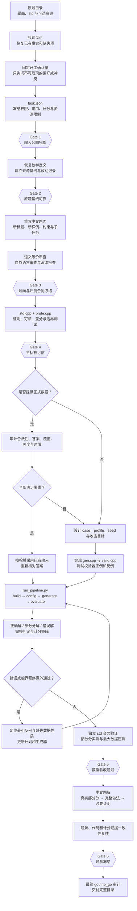

# build-cp-testdata

`build-cp-testdata` 是一套面向算法竞赛命题与制题的 Codex Skill。它从一个原题目录出发，完成题目盘点、中文题面重写、标准解验证、测试数据审计或生成、错误程序攻击、部分分实测、题解撰写与发布验收，最终得到可复现、可审核的问题包。

这套工作流不把“文件已经生成”视为完成。题面、标答、数据和题解分别经过验收门；任何上游改动都会使相关下游证据失效并触发重检。

## 核心能力

| 环节 | 能力 |
|---|---|
| 输入盘点 | 递归检索原题目录，识别题面、标准解、题解、已有数据、错误解、部分分程序与子任务设置 |
| 需求冻结 | 使用固定开工确认单确定输出位置、交付范围、计分方式、数据数量、题面风格、改写范围、目标选手与题包格式 |
| 题面重写 | 保持数学问题和满分核心算法不变，将中文、英文或双语原题重写为完整中文题面，并重新设计样例与子任务 |
| 标准解校验 | 审核 `std.cpp`，另写 `brute.cpp`，进行小规模穷举、差分测试、边界检查和复杂度审计 |
| 数据处理 | 先审计已有数据；合法、正确且强度达标时按哈希直接采用，否则使用固定 seed 的生成器补全或重建 |
| 计分配置 | 支持独立测试点、子任务捆绑与混合计分，并从冻结的计分单元生成 `data/config.yaml` |
| 强度验证 | 使用正确解、真实部分分解和多类已证明错误的程序跑完整矩阵；错误程序意外通过时自动回到数据设计环节 |
| 资源一致性 | 对生成器、校验器、标答、暴力、候选程序和压测统一应用时间、内存与栈限制 |
| 题解与发布 | 编写覆盖所有真实部分分算法的中文题解，完成独立复核、时限压测和最终 `go` / `no_go` 审计 |

新增的标准解与真实部分分程序采用仓库约定的 Jiangly 风格，并优先复用经过测试的本地算法模板。题面、题解和报告使用统一的中文文本、Markdown、公式与自然语言审校规则。

## 工作流框架



图中的返工不是随机重试。每次补强都必须先定位错误程序的具体缺陷，再把缺失性质映射到数据 profile 或确定性构造。若数学定义、接口、计分单元、资源限制等上游内容发生变化，工作流会按失效矩阵重新运行所有受影响的阶段。

## 输入要求

向 Skill 提供一个原题文件夹。目录中应至少能够恢复：

- 一份 Markdown 题面；题面可以是中文、英文或双语，最终输出统一为中文；
- 一份标准程序。若标准程序缺失、接口不匹配或无法验证，必须先走独立求解与标答验收流程；
- 题目的数学定义、输入输出和约束。

以下内容均可缺省，Skill 会在盘点后按需补全：

- 原题题解；
- 样例或正式数据；
- 错误解答代码；
- 部分分程序；
- 子任务表与原部分分设置；
- 生成器、校验器或 checker。

已有数据不会被默认丢弃或覆盖。工作流会先检查文件数量、格式、约束、答案、重复情况、覆盖、强度和性能；全部合格时直接采用，仅替换不合格部分。

## 安装

将仓库克隆到 Codex 的 Skills 目录：

```text
git clone https://github.com/wtz2333/build-cp-testdata-skill.git ~/.codex/skills/build-cp-testdata
```

Windows PowerShell 可以使用：

```powershell
git clone https://github.com/wtz2333/build-cp-testdata-skill.git "$env:USERPROFILE\.codex\skills\build-cp-testdata"
```

重新打开 Codex 任务后，`build-cp-testdata` 会作为可用 Skill 被发现。

## 使用方法

### 1. 发起任务

提供原题目录和目标，例如：

```text
使用 $build-cp-testdata 处理 D:\problems\original-a。
输出到 D:\problems\finished；需要完整题包。
```

Skill 会先进行只读盘点，再发送固定的[开工确认单](assets/intake-questionnaire.md)。不要在盘点前手工重复整理编译标准、输入输出或已有文件；能够从目录中发现的事实会自动填写。

### 2. 完成开工确认

确认单用于冻结以下选择：

1. 输出位置与交付范围；
2. 独立、捆绑或混合计分；
3. 数据数量与分组设计权限；
4. 完全形式化、轻量背景或主题化题面；
5. 改写范围、目标选手和题包格式；
6. 技术限制、主人公代称和额外要求。

除原题路径外，可以明确回答“由你决定”。这种授权会写入 `task.json`，并记录最终选择及理由，不会静默套用默认值。

### 3. 运行可执行流水线

工作区根据 [`assets/task.example.json`](assets/task.example.json) 和 [`assets/pipeline.example.json`](assets/pipeline.example.json) 生成实际的 `task.json` 与 `pipeline.json`。完整构建命令为：

```text
python scripts/run_pipeline.py pipeline.json all
```

也可以单独运行一个阶段：

| 命令 | 作用 |
|---|---|
| `build` | 编译生成器、校验器、标答和配置中的候选程序 |
| `config` | 从当前计分单元派生并检查 `data/config.yaml` |
| `generate` | 生成或接纳输入，执行校验、可复现性检查并计算标准答案 |
| `evaluate` | 在全部数据上运行候选程序，生成判定和分数矩阵 |
| `all` | 按依赖顺序完成以上全部阶段 |

所有程序都使用同一份冻结的运行时资源策略。`stack_limit_mib` 默认等于 `memory_limit_mib`；Windows 通过链接器设置 PE 栈保留，POSIX 在子进程执行前设置 `RLIMIT_STACK`。

## 计分模式

| 模式 | 含义 | 数据数量 |
|---|---|---|
| `per_case` | 每个测试点独立计分 | 用户必须提供固定正整数 `N` |
| `bundled` | 一个子任务内所有测试点及依赖全部通过才得分 | 可固定，也可采用 20～40 组的强度驱动策略 |
| `mixed` | 独立测试点与捆绑子任务并存 | 用户必须提供固定正整数 `N` |

测试点分组、校验器分组和计分单元是三个不同概念。每个正式测试只属于一个计分单元，依赖关系必须无环，所有单元分值之和等于总分。

## 典型产物

具体文件名和目录由题包合同决定。普通目录格式通常包含：

```text
problem-package/
├── statement.md
├── task.json
├── pipeline.json
├── std.cpp
├── brute.cpp
├── gen.cpp
├── valid.cpp
├── data/
│   ├── 001.in
│   ├── 001.ans
│   ├── ...
│   └── config.yaml
├── solutions/
│   ├── accepted/
│   ├── partial/
│   └── wrong/
├── logs/
├── reports/
└── solution.md
```

默认交付完整目录，不自动创建 ZIP。只有用户明确要求或目标平台强制要求时，才会生成并复验归档文件。

## 仓库结构

```text
build-cp-testdata/
├── SKILL.md                 # Skill 主入口、验收门和完整编排流程
├── agents/openai.yaml       # Codex UI 元数据与默认提示
├── assets/                  # 问卷、配置示例、题面/题解骨架与 C++ 模板
│   └── cpp-templates/       # 已验证的常用算法组件
├── references/              # 按阶段加载的题面、数据、计分、代码与审计规范
├── scripts/run_pipeline.py  # 确定性构建、生成、验证、判定与计分入口
├── scripts/test_pipeline.py # 流水线单元测试
└── scripts/test_cpp_templates.cpp
                              # C++ 模板编译与行为测试
```

重要规范入口：

- [`SKILL.md`](SKILL.md)：主工作流与六个验收门；
- [`references/input-discovery.md`](references/input-discovery.md)：原题目录盘点；
- [`references/statement-rewrite.md`](references/statement-rewrite.md)：题面重写与冻结；
- [`references/oracle-and-complexity-audit.md`](references/oracle-and-complexity-audit.md)：标答与暴力验证；
- [`references/existing-data-audit.md`](references/existing-data-audit.md)：已有数据审计；
- [`references/test-design.md`](references/test-design.md)：对抗性数据设计；
- [`references/testdata-config.md`](references/testdata-config.md)：计分配置生成；
- [`references/runtime-resource-policy.md`](references/runtime-resource-policy.md)：统一时间、内存与栈策略；
- [`references/solution-writing.md`](references/solution-writing.md)：部分分与完整题解；
- [`references/state-and-release-audit.md`](references/state-and-release-audit.md)：失效矩阵与最终发布审计。

## 质量保证

正式发布前，工作流至少检查：

- 题面数学定义、接口和约束与原题等价；
- 样例和正式输入均通过校验器，且不存在额外 token；
- 标答与独立暴力或独立实现交叉一致；
- 固定 seed 能逐字节复现输入和答案；
- 正式输入原则上不重复，文本文件使用 UTF-8 与 LF；
- `data/config.yaml` 与冻结的计分单元一致；
- 每种真实部分分算法和已知错误类型都经过完整数据实测；
- 最大数据在统一资源限制下完成重复压测；
- 题面、题解、代码、计分和报告之间没有未解决矛盾；
- 最终审计结果为 `go`，且阻塞问题列表为空。

## 开发与自检

运行流水线测试：

```text
python scripts/test_pipeline.py
```

检查 C++ 模板：

```text
g++ -std=c++14 -O2 -Wall -Wextra -Werror scripts/test_cpp_templates.cpp -o test_cpp_templates
./test_cpp_templates
```

核心竞赛程序使用题目合同冻结的 C++ 标准与编译参数；仓库内模板目前按 C++14 及以上环境维护。所有文本文件使用 UTF-8 和 LF 行尾。

## 文本规范

题面和题解遵循所选平台的 Markdown 规范，并共享公式、代码围栏、链接、表格和渲染检查。洛谷格式任务以官方题面与题解规范为准。

人类可读文本还参考 [Humanizer-zh](https://github.com/op7418/Humanizer-zh) 中适合技术写作的原则，只吸收直述、稳定术语、删减套话和避免模板化表达等内容，不采用反检测、刻意口语化或故意制造杂乱的做法。
